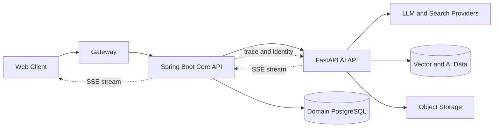
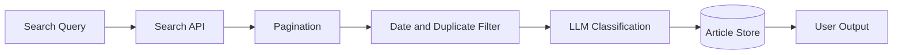
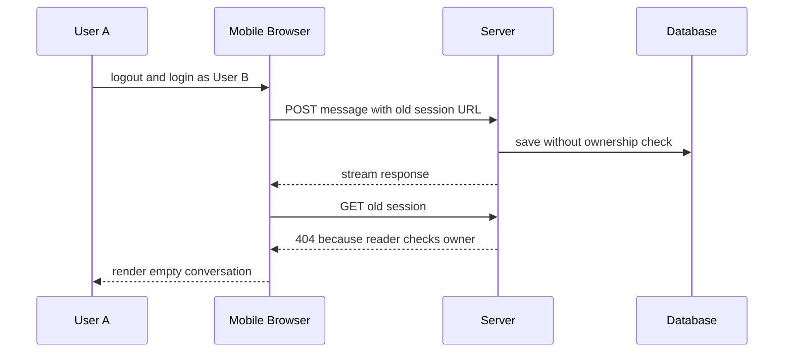
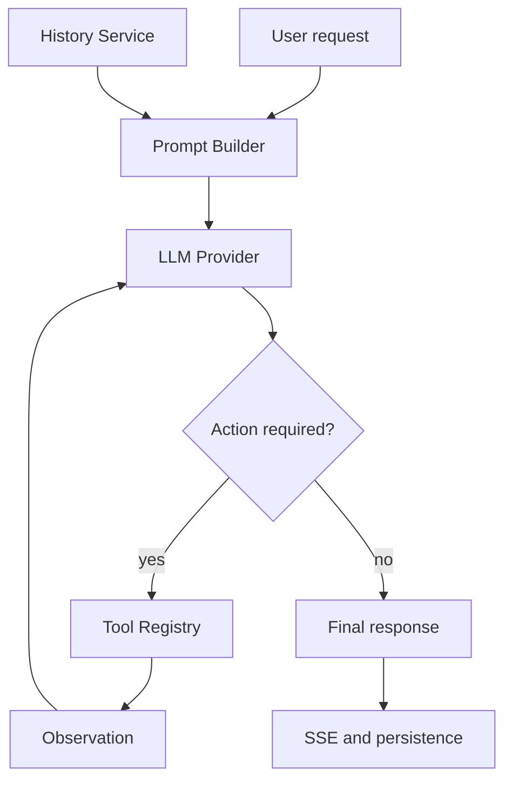

# 김영현의 Engineering Stories

기업용 생성형 AI 플랫폼을 만들며 해결한 문제와 설계 판단을 정리했습니다. 기능 목록보다 문제를 어떤 경계로 나누고, 무엇을 근거로 원인을 좁혔으며, 어떤 트레이드오프를 선택했는지를 설명합니다.

회사 프로젝트의 소스 코드와 저장소는 공개하지 않습니다. 아래 내용은 공개 가능한 기술 구조와 역할, 검증 결과만 재구성했으며 고객 데이터, 사내 주소, 계정과 운영 설정은 제외했습니다.

## 목차

- [1. 역할과 시스템 경계](#1-역할과-시스템-경계)
- [2. 다이닝브랜즈그룹 DinAI](#2-다이닝브랜즈그룹-dinai)
  - [Case 1. 뉴스 수집의 조용한 누락](#case-1-뉴스-수집의-조용한-누락)
  - [Case 2. Bedrock 호출이 30분 뒤 실패한 이유](#case-2-bedrock-호출이-30분-뒤-실패한-이유)
  - [Case 3. 사라진 채팅에서 발견한 세션 소유권 결함](#case-3-사라진-채팅에서-발견한-세션-소유권-결함)
  - [Case 4. 비동기 감사 로그의 공유 상태 오염](#case-4-비동기-감사-로그의-공유-상태-오염)
  - [Case 5. DAU를 계산하기 전에 DAU를 정의한 이유](#case-5-dau를-계산하기-전에-dau를-정의한-이유)
  - [Case 6. 프롬프트 변경을 배포하지 않은 결정](#case-6-프롬프트-변경을-배포하지-않은-결정)
- [3. 대상그룹 AI 플랫폼](#3-대상그룹-ai-플랫폼)
  - [Case 7. 토큰 한도 안에서 최근 대화를 보존하는 컨텍스트 구성](#case-7-토큰-한도-안에서-최근-대화를-보존하는-컨텍스트-구성)
  - [Case 8. 프롬프트 중심 워크플로를 역할이 분리된 ReAct 구조로 전환](#case-8-프롬프트-중심-워크플로를-역할이-분리된-react-구조로-전환)
  - [Case 9. 대화와 첨부파일을 감사 가능한 이벤트로 설계](#case-9-대화와-첨부파일을-감사-가능한-이벤트로-설계)
- [4. 반복해서 적용하는 원칙](#4-반복해서-적용하는-원칙)

## 1. 역할과 시스템 경계

하이아스에서 SI 개발 대리로 근무하며 React 클라이언트, Spring Boot 도메인 API, Python AI API와 PostgreSQL 데이터 계층을 연결했습니다. 특정 프레임워크 한 부분만 구현하기보다 요청이 브라우저에서 시작해 인증·프록시·LLM·DB를 거쳐 다시 스트리밍 응답으로 돌아오는 전체 경로를 다뤘습니다.



이 구조에서 같은 “응답 지연”도 서로 다른 문제일 수 있습니다.

| 관찰 지점 | 대표 실패 | 확인해야 할 경계 |
|---|---|---|
| 브라우저 | 응답 소실, 잘못된 화면 복귀 | 라우팅 상태, 사용자 전환, SSE 소비 |
| Core API | 프록시 오류, 권한 오류 | 세션 소유권, 커넥션 풀, 오류 매핑 |
| AI API | 에이전트 실패, 긴 처리 시간 | 비동기 작업, 재시도, 상태 격리 |
| LLM·검색 API | 타임아웃, 누락, 비용 증가 | SDK 의미, 페이지 경계, 호출 상한 |
| DB·리포트 | 수치 불일치, 감사 정보 오염 | 이벤트 정의, 조인 누락, 트랜잭션 시점 |

따라서 조사할 때 성공 로그 하나를 전체 성공으로 간주하지 않습니다. 각 경계의 입력, 출력, 식별자와 시간을 연결하고 반증 가능한 가설부터 제거합니다.

## 2. 다이닝브랜즈그룹 DinAI

DinAI는 채팅, RAG, 지식베이스, 뉴스 클리핑, 사내 특화 에이전트와 관리자 기능을 제공하는 기업용 AI 플랫폼입니다. React, Spring Boot, FastAPI, PostgreSQL, AWS Bedrock으로 분리된 저장소와 실행 환경 전반에서 기능과 운영 문제를 다뤘습니다.

### Case 1. 뉴스 수집의 조용한 누락

#### 문제

뉴스 클리핑 작업은 성공으로 종료됐지만 특정 브랜드와 전일 기사가 빠졌습니다. 파이프라인은 검색, 날짜·중복 정제, LLM 분류, DB 반영, 요약으로 이어지므로 최종 노출 건수만 보고 어느 단계에서 누락됐는지 알 수 없었습니다.



#### 조사와 원인 분리

| 가설 | 검증 방법 | 판단 |
|---|---|---|
| 검색 API에 원문이 없음 | API 원본과 검색 웹 결과 대조 | 일부 쿼리에서 반증 |
| LLM이 기사를 제외함 | LLM 투입 전후 건수 분리 | 수집 누락과 별도 문제 |
| 검색 문법이 잘못됨 | 쿼리별 최근 결과와 최신 시각 기록 | 영문 `OR`이 의도한 연산자로 동작하지 않음 |
| 날짜 필터가 전일 기사를 제거함 | 필터 전후 게시 시각 대조 | 핵심 원인 아님 |
| 첫 페이지 제한 | 쿼리별 `total`과 실제 수집 건수 대조 | 최신 100건이 당일 기사로 차면 전일 기사가 조용히 누락 |

두 결함은 독립적이었습니다. 검색 연산자가 잘못된 27개 쿼리는 최근 이틀 결과가 0건이었고, 결과가 많은 쿼리는 첫 100건까지만 가져와 날짜 창을 완성하지 못했습니다.

#### 설계 판단

- 검색 연산자를 실제 API가 지원하는 형태로 바꾸고 브랜드 오타를 정정했습니다.
- 쿼리별 결과 수와 최신 기사 시각을 기록해 “호출 성공”과 “수집 완결성”을 분리했습니다.
- 고정 한 페이지 대신 목표 날짜보다 오래된 기사가 나올 때까지 페이지를 진행했습니다.
- 무제한 호출을 피하기 위해 최대 페이지 수와 페이지 사이 간격을 두었습니다.
- 429 위험과 후속 LLM 비용을 수집 완결성의 트레이드오프로 명시했습니다.

#### 검증과 결과

실제 API를 같은 조건으로 다시 실행했습니다. 84개 쿼리 중 6개가 첫 100건 경계에 걸렸고, 날짜·중복 정제 후 기사 수가 545건에서 645건으로 늘었습니다. 이는 한 번의 실수집 결과이며 장기 개선율로 일반화하지 않았습니다.

수집량 증가는 LLM 입력량과 실행 시간을 키웠습니다. 수집 계층의 개선이 후속 계층의 용량 문제를 만들 수 있음을 확인했고, 이것이 다음 타임아웃 분석으로 이어졌습니다.

### Case 2. Bedrock 호출이 30분 뒤 실패한 이유

#### 문제

대형 기사 배치의 LLM 분류가 약 30분 후 `Read timeout`으로 실패했습니다. 설정은 읽기 제한 600초, `max_attempts=2`였기 때문에 처음에는 최대 20분으로 해석됐습니다. 그러나 실제 관측값과 계산이 맞지 않았습니다.

#### 계층별 가설 검증

1. Nginx나 Core API 제한을 확인했습니다. API는 작업을 시작한 뒤 202를 반환하고 실제 분류는 AI API의 백그라운드 작업에서 실행됐으므로 상류 HTTP 제한을 원인에서 제외했습니다.
2. NAT·ALB 경로를 의심했지만, 해당 경로가 없는 로컬 전체 스택에서도 같은 30분대 실패가 재현됐습니다.
3. 모델 응답 변동성만으로는 `600초 × 3회`와 일치하는 패턴을 설명할 수 없었습니다.
4. 1초 제한 대조 실험에서 최초 호출 이후 재시도 두 번을 확인하고 SDK 변환 코드를 추적했습니다.

#### Root Cause

사용한 SDK에서 `max_attempts=2`는 총 두 번이 아니라 최초 요청에 더해 재시도를 두 번 수행한다는 의미였습니다.

```text
최악 대기 시간 = read timeout × (최초 요청 1회 + 재시도 횟수)
               = 600초 × 3회
               = 약 1,800초
```

설정을 1,200초로 늘리기만 하면 최악 대기는 60분으로 증가합니다. 긴 LLM 분류는 동일 입력을 재시도할 때 시간과 비용이 함께 중복된다는 점도 고려해야 했습니다.

#### 선택한 설계

- 재시도를 0으로 설정해 실제 호출을 한 번으로 제한했습니다.
- 제공자 타임아웃 예외를 일반 오류보다 먼저 분류했습니다.
- 기존 공용 예외 계약을 재사용해 작업 상태를 `LLM_TIMEOUT`으로 기록했습니다.
- 호출 분할은 더 구조적인 대안이지만 당시 수정 범위와 분리했습니다.

#### 검증과 한계

개발 환경의 1,297건 작업은 약 1,200초 뒤 한 번의 실패로 종료됐고 `LLM_TIMEOUT`으로 기록됐습니다. 재시도 제거와 오류 식별은 검증됐지만, 20분이면 모든 대형 배치가 성공한다는 가설은 오히려 반증됐습니다. 이후 개선은 입력 분할, 출력 상한과 부분 재처리 단위 설계가 필요합니다.

### Case 3. 사라진 채팅에서 발견한 세션 소유권 결함

#### 증상

모바일 Safari에서 계정을 바꾼 뒤 답변이 잠시 보이다 사라졌습니다. 저장 로그와 DB 행은 존재했지만 직후 조회 API는 404를 반환했습니다. 표면적으로는 데이터 소실처럼 보였지만 실제로는 인증 경계의 비대칭이었습니다.

#### 요청 흐름 재구성



삭제 여부, DB 복제 지연, 조회 예외의 404 변환과 화면 처리까지 후보를 열어 두었습니다. DB에 행이 남아 있고 리더·라이터 분리가 없다는 사실로 삭제와 복제 지연을 배제했습니다. 계정별 API 호출을 대조하면서 읽기와 쓰기의 권한 계약이 다르다는 것을 확인했습니다.

#### Root Cause

- 모바일 로그아웃이 이전 채팅 deep link를 로그인 후 복귀 URL로 보존했습니다.
- 쓰기 API는 전달받은 세션 ID의 소유권을 확인하지 않았습니다.
- 읽기 API는 현재 사용자와 세션 소유자가 다르면 404를 반환했습니다.
- 화면은 조회 실패를 빈 대화로 표현해 저장된 데이터가 사라진 것처럼 보였습니다.

#### 수정과 보안 판단

화면만 초기화하면 교차 계정 쓰기 취약점이 남고, 서버 검사만 추가하면 사용자는 계속 잘못된 URL로 돌아갑니다. 따라서 서버 쓰기 경로에 소유권 검사를 추가하고 클라이언트의 명시적 로그아웃에서는 이전 채팅 URL을 폐기했습니다.

Playwright E2E로 로그아웃 후 랜딩 복귀, 비소유 세션 쓰기 차단, 차단된 요청의 DB 미저장과 정상 세션 새로고침 유지를 확인했습니다. 읽기와 쓰기는 동일한 리소스 소유권 계약을 가져야 한다는 회귀 조건도 남겼습니다.

### Case 4. 비동기 감사 로그의 공유 상태 오염

#### 문제

한 요청에서 이미지 여러 장이 서로 다른 자원 ID로 정상 생성됐지만 감사 로그에는 마지막 이미지 ID가 반복됐습니다. 코드만 읽었을 때는 루프마다 다른 값을 넣는 것처럼 보였기 때문에 운영 DB의 감사 행과 실제 자산을 먼저 대조했습니다.

#### 동시성 모델

```text
loop 1: shared_actor.resource_id = A -> create_task(insert(shared_actor))
loop 2: shared_actor.resource_id = B -> create_task(insert(shared_actor))
loop 3: shared_actor.resource_id = C -> create_task(insert(shared_actor))

event loop executes inserts after synchronous loop
insert 1 reads C
insert 2 reads C
insert 3 reads C
```

중복 작업 실행과 영상 생성 경로도 확인했지만, 작업 시작 상태가 중복을 막고 해당 경로에는 감사 이벤트 호출이 없었습니다. 핵심은 하나의 mutable 객체를 반복 변경한 뒤 지연 실행 태스크에 같은 참조를 넘긴 것이었습니다.

#### 설계 선택

| 대안 | 장점 | 문제 |
|---|---|---|
| 각 호출부에서 새 상태 객체 생성 | 해당 기능의 의도가 명확함 | 다른 호출부에서 같은 결함 재발 가능 |
| 비동기 태스크 내부에서 복사 | 공통 처리 가능 | 태스크가 시작될 때 이미 값이 바뀌었을 수 있음 |
| 이벤트 발행 경계에서 즉시 복사 | 호출 시점의 스냅샷 보장 | 작은 복사 비용 발생 |

감사 이벤트는 발생 시점의 사실을 기록해야 하므로 발행 함수가 입력 상태를 즉시 깊은 복사한 뒤 태스크에 넘기도록 했습니다. 호출부마다 규칙을 기억하게 하지 않고 공통 계약 한 곳에서 불변 스냅샷을 보장했습니다.

동일 상태 객체로 이벤트 세 건을 발행하는 회귀 테스트를 작성해 수정 전 실패와 수정 후 통과를 확인했습니다. 로컬 Docker와 개발 환경에서도 서로 다른 ID 세 건이 저장되는 것을 검증했습니다.

### Case 5. DAU를 계산하기 전에 DAU를 정의한 이유

#### 문제

대시보드 DAU와 재현 SQL 결과가 15명과 16명으로 달랐습니다. 이후 전체 합계와 본부별 합계도 135 대 134, 44 대 42로 달랐습니다. 숫자를 맞추는 SQL보다 먼저 “활성 사용자”와 조직 기준을 결정해야 했습니다.

#### 지표 계약

| 결정 항목 | 선택 | 포기한 의미 |
|---|---|---|
| 활동 이벤트 | 성공 로그인 | 실제 AI 기능 사용량과 동일하지 않음 |
| 모수 | 본사 직원 | 매장 계정 제외 |
| 조직 시점 | 현재 소속 | 로그인 당시 조직 스냅샷 미사용 |
| 조직 집계 | 상위 조직까지 재귀 탐색 | 조직도에 없는 코드는 자동 포함 불가 |
| 제외 정책 | 합의된 최상위 조직·테스트 계정 | 전체 원시 합계와 차이 발생 가능 |

기존 활성 사용자 기준은 특정 실행 유형에 의존해 독립 기능만 사용한 사용자를 놓쳤습니다. 보고 목적에 맞춰 성공 로그인 로그를 분자로 사용하고 현재 본사 재직자를 분모로 고정했습니다.

#### 합계 차이를 다룬 방법

전체와 세부 합계를 임의 보정하지 않고 매핑되지 않은 키를 출력했습니다. 135 대 134 차이는 재귀 조건에서 최상위 노드 자체가 제외된 결과였고, 44 대 42 차이는 조직도에 없는 테스트 부서 계정 두 건이 INNER JOIN에서 사라진 결과였습니다.

이 사례에서 SQL은 마지막 단계였습니다. 이벤트, 모수, 조직 시점, 제외 정책을 먼저 고정해야 같은 이름의 지표가 보고서마다 다른 의미를 갖지 않습니다.

### Case 6. 프롬프트 변경을 배포하지 않은 결정

#### 문제

HR 에이전트가 노동·법률 질문에 단정적으로 읽힐 수 있는 표현을 사용했습니다. 단순 금지 문구 추가는 유사 표현으로 우회될 수 있고, 답변을 지나치게 제한하면 사용성이 떨어질 수 있었습니다.

#### 검증 체계

- 신규 문제 7개와 기존 정상 동작 8개로 골든셋을 구성했습니다.
- 문제 응답과 원문 대화를 연결해 기대 결과를 문장 수준으로 정의했습니다.
- API 직접 호출만으로는 실제 인증·멀티턴·UI 상태를 검증할 수 없어 브라우저 경로로 전환했습니다.
- 사실 인용, 법적 판단 축소, 안내 문구의 허용 범위를 별도 기준으로 나눴습니다.

#### 요구 변경과 판단

초기 목표는 신중한 판단 유보와 전문가 확인 안내였습니다. 이후 이해관계자 피드백으로 판단 불가 안내와 외부 기관 안내 자체를 제거하는 방향으로 요구가 바뀌었습니다. 기존 골든셋의 PASS 정의가 더는 유효하지 않았습니다.

개발 환경에서 동작했다는 이유만으로 배포하지 않았습니다. 요구 충돌과 느슨한 합격 기준을 확인하고 관련 변경만 선택적으로 되돌렸습니다. 프롬프트 변경도 코드와 동일하게 승인 가능한 기대 결과, 회귀셋, 배포판 기준과 롤백 단위를 가져야 한다는 원칙을 세웠습니다.

장기 품질 개선 수치는 확인되지 않았으므로 성과로 주장하지 않습니다. 이 사례의 결과는 잘못 정의된 성공 기준으로 운영 배포하는 위험을 차단한 것입니다.

## 3. 대상그룹 AI 플랫폼

대상그룹 AI 플랫폼에서는 React·TypeScript 클라이언트, Spring Boot 도메인 API, Python LLM API와 배치 계층을 연결했습니다. 사용자·회사 범위의 권한, 대화 컨텍스트, 프롬프트 보안, 감사 추적과 스트리밍 워크플로를 주요 경계로 다뤘습니다.

### Case 7. 토큰 한도 안에서 최근 대화를 보존하는 컨텍스트 구성

#### 문제

대화 히스토리를 오래된 순서부터 입력 한도에 채우는 구현에서는 과거의 긴 대화가 예산을 먼저 사용했습니다. 한도에 도달하면 반복을 중단했기 때문에 사용자의 직전 질문과 답변이 모델 입력에서 빠지는 현상이 생겼습니다. 문맥이 가장 필요한 최근 턴이 먼저 버려지는 선택이었습니다.

#### 이전 알고리즘

```text
history = oldest -> newest
for conversation in history:
    if used + size(conversation) > budget:
        break
    include(conversation)
```

#### 변경한 알고리즘

```text
candidates = newest -> oldest
for conversation in candidates:
    if conversation fits:
        select(conversation)
    else if meaningful budget remains:
        select(truncated conversation with marker)
        break
    else:
        break

return reverse(selected)  // 모델에는 시간순으로 전달
```

최신 대화부터 예산을 배정하되 모델에 전달할 때는 시간순으로 되돌렸습니다. 마지막으로 포함 가능한 턴은 무조건 자르지 않고 최소 잔여 예산과 사용자 메시지 크기를 확인한 뒤 assistant 응답 일부만 명시적인 절단 표식과 함께 포함했습니다.

#### 함께 해결한 프롬프트 경계

히스토리, 첨부파일과 현재 요청을 문자열 뒤에 계속 이어 붙이면 각 노드의 출력 형식 지시와 공통 시스템 지시가 충돌했습니다. 노드별 템플릿이 자신의 입력 구역을 가지도록 재구성하고 중복 지시를 제거했습니다. 데이터인 대화 내용과 실행 규칙인 시스템 지시를 같은 수준의 문자열로 취급하지 않도록 경계를 분리했습니다.

#### 한계

초기 구현은 문자 수에 토큰 비율을 적용한 근사치였고 이후 실제 토큰 계산을 사용하는 구조로 발전시켰습니다. 최근 대화 우선은 일반적으로 유용하지만 오래된 핵심 사실을 잃을 수 있으므로 장기 메모리나 요약은 별도 문제입니다.

### Case 8. 프롬프트 중심 워크플로를 역할이 분리된 ReAct 구조로 전환

#### 전환 전 문제

LLM 호출, 프롬프트 조립, 도구 선택, 히스토리 변환, 스트리밍과 상태 전이가 큰 provider·workflow 모듈에 결합돼 있었습니다. 기능을 추가할 때 한 파일의 조건문과 문자열 조립을 함께 수정해야 했고, 도구별 입력·출력 계약을 독립적으로 검증하기 어려웠습니다.

#### 설계 목표

- 프롬프트 규칙과 실행 코드를 분리합니다.
- 도구의 이름, 입력 스키마와 실행 함수를 한 레지스트리에서 관리합니다.
- 모델 제공자 차이를 워크플로에서 격리합니다.
- 히스토리를 문자열 덩어리가 아니라 역할이 있는 message 배열로 변환합니다.
- ReAct 루프의 최대 반복과 종료 조건을 명시합니다.
- 기존 SSE 계약과 DB 저장 경로는 유지합니다.

#### 책임 분리

| 컴포넌트 | 책임 |
|---|---|
| LLM Provider | 모델 호출, 스트리밍, 사용량 응답 정규화 |
| Prompt Builder | XML 구역과 현재 요청·첨부·히스토리 조립 |
| History Service | 최신 대화 우선 선택과 message 변환 |
| Tool Registry | 검색·이미지 등 도구 스키마와 실행 진입점 관리 |
| Workflow Runner | thought–action–observation 반복과 종료 판단 |
| Audit Logger | 실행 결과와 자원 행위 기록 |

XML 구조는 역할, 제약, 컨텍스트, 사용자 입력과 출력 계약의 경계를 모델이 구분하도록 만들었습니다. ReAct 루프는 모델이 선택한 도구만 레지스트리를 통해 실행하고 관찰 결과를 다음 판단에 돌려주도록 했습니다.



#### 변경 범위와 검증 관점

기존 대형 모듈을 줄이고 역할별 모듈을 추가하면서 코드 기준 18개 파일, 약 2천 줄 추가와 2천3백 줄 삭제 규모로 전환했습니다. 라인 수 감소 자체를 성과로 보지는 않았습니다. 핵심 검증 조건은 기존 요청 스키마, 첨부 처리, 스트리밍 이벤트와 저장 계약을 깨지 않으면서 도구 호출과 종료 조건을 분리하는 것이었습니다.

전환 후 코드 리뷰에서 발견된 저장 데이터 절단 문제와 경계 오류를 별도 수정했습니다. 구조 변경은 완료 선언보다 기존 계약을 다시 확인하는 과정까지 포함해야 한다고 판단했습니다.

### Case 9. 대화와 첨부파일을 감사 가능한 이벤트로 설계

#### 요구사항

기업용 AI 대화는 최종 응답만 저장해서는 누가, 어느 세션에서, 어떤 자원에, 어떤 경로로 행위를 수행했는지 설명하기 어렵습니다. 대화 생성과 첨부파일 업로드를 서로 다른 활동 유형으로 추적하면서 하나의 요청 흐름으로 연결해야 했습니다.

#### 이벤트 모델

| 필드 집합 | 목적 |
|---|---|
| actor | 사용자와 회사 범위 식별 |
| activity | 대화 생성, 파일 업로드 등 행위 분류 |
| resource | 대화·첨부파일 대상 식별 |
| trace | Spring API부터 AI API까지 요청 연결 |
| channel | Web, Mobile, API 접근 경로 구분 |
| result | 성공·실패와 처리 시간 기록 |
| usage | 입력·출력 토큰과 에이전트 식별 |

Spring 계층에서 전달한 trace와 HTTP 세션 정보가 AI API의 스트리밍 완료 시점까지 이어지도록 했습니다. 대화는 응답과 토큰 사용량을 포함하는 `DATA_CREATE`, 첨부파일은 개수·크기·형식을 포함하는 `FILE_UPLOAD`로 분리했습니다.

#### 기술적 고려

- 스트리밍 시작 시점이 아니라 최종 결과가 확정된 시점에 대화 성공 이벤트를 기록합니다.
- 파일이 여러 개여도 요청 단위 trace로 묶되 파일 메타데이터는 개별 식별이 가능해야 합니다.
- User-Agent가 없거나 브라우저로 판별되지 않으면 API 채널로 안전하게 분류합니다.
- 감사 로그 실패가 사용자 응답 전체를 다시 실행하게 만들지 않도록 비즈니스 처리와 실패 경계를 구분합니다.
- 민감한 프롬프트와 응답은 저장 정책과 암호화 경계를 따르며 공개 문서에는 실제 값을 남기지 않습니다.

이 설계는 장애 조사, 보안 감사와 사용량 분석이 같은 trace를 기준으로 대화될 수 있게 했습니다. 다만 로그가 존재한다는 사실만으로 규정 준수가 완성되는 것은 아니며 보존 기간, 조회 권한, 마스킹 정책은 별도의 운영 통제가 필요합니다.

## 4. 반복해서 적용하는 원칙

### 증상과 원인을 다른 계층으로 분리합니다

화면에서 데이터가 사라져도 저장 실패라고 단정하지 않습니다. 브라우저 상태, 권한 검사, API 오류 변환과 DB 행을 같은 타임라인에 놓고 확인합니다.

### 설정 이름보다 실행 의미를 검증합니다

SDK의 `max_attempts`처럼 익숙해 보이는 이름도 실제 의미가 다를 수 있습니다. 짧은 제한의 대조 실험과 라이브러리 실행 경로를 함께 확인합니다.

### 지표는 SQL보다 계약이 먼저입니다

분자, 분모, 제외 조건과 시점을 합의하지 않은 수치는 정확하게 계산해도 잘못된 의사결정을 만듭니다. 전체와 세부 합계가 다르면 숫자를 맞추기 전에 매핑되지 않은 행을 찾습니다.

### 비동기 경계에는 값의 소유권이 필요합니다

지연 실행에 mutable 상태를 넘길 때는 누가 언제 값을 읽는지를 명확히 합니다. 감사 이벤트처럼 시점이 중요한 데이터는 발행 경계에서 스냅샷을 만듭니다.

### 배포하지 않는 것도 기술적 결정입니다

테스트가 통과해도 요구사항과 합격 기준이 충돌하면 배포를 보류합니다. 관련 변경만 되돌릴 수 있도록 범위를 작게 유지하고, 확인되지 않은 품질 개선은 성과로 주장하지 않습니다.
