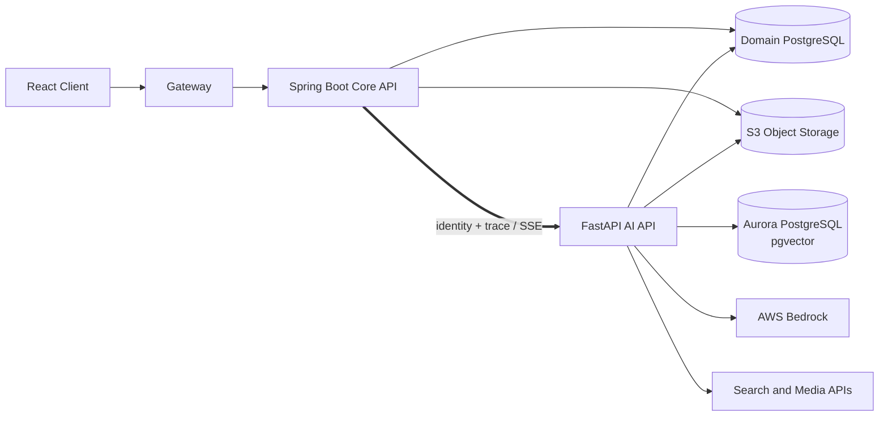
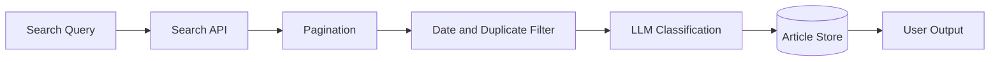
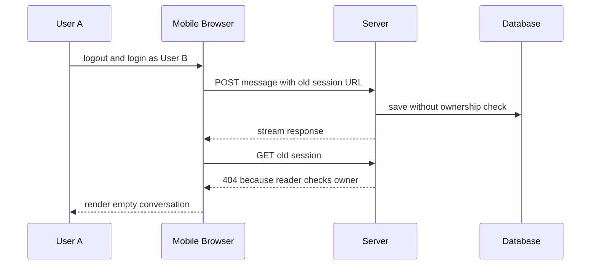
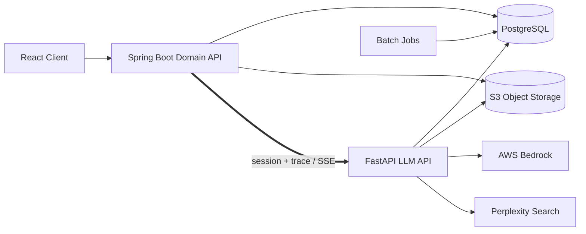
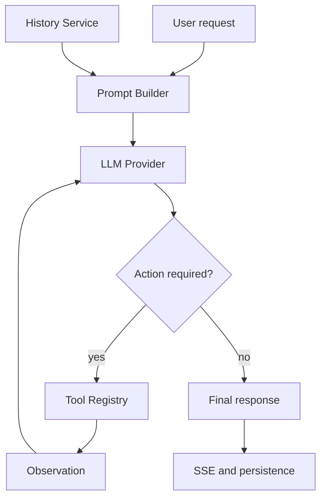

# Detailed Story of [김영현](https://github.com/dudgus197493)

## Table of Contents

- [1. Outline](#1-outline)
  - [1.1. Profile](#11-profile)
  - [1.2. Education](#12-education)
  - [1.3. Skills](#13-skills)
  - [1.4. Experiences](#14-experiences)
- [2. Introduction](#2-introduction)
  - [2.1. End-to-End Engineering](#21-end-to-end-engineering)
  - [2.2. Debugging](#22-debugging)
  - [2.3. Documentation](#23-documentation)
  - [2.4. Testing](#24-testing)
- [3. Commercial Projects](#3-commercial-projects)
  - [3.1. 다이닝브랜즈그룹 DinAI](#31-다이닝브랜즈그룹-dinai)
    - [3.1.1. Platform Architecture](#311-platform-architecture)
    - [3.1.2. News Clipping Collection](#312-news-clipping-collection)
    - [3.1.3. Bedrock Timeout and Retry](#313-bedrock-timeout-and-retry)
    - [3.1.4. Session Ownership](#314-session-ownership)
    - [3.1.5. Asynchronous Audit State](#315-asynchronous-audit-state)
    - [3.1.6. DAU Definition](#316-dau-definition)
    - [3.1.7. HR Agent Evaluation](#317-hr-agent-evaluation)
  - [3.2. 대상그룹 AI 플랫폼](#32-대상그룹-ai-플랫폼)
    - [3.2.1. Platform Architecture](#321-platform-architecture)
    - [3.2.2. Conversation Context](#322-conversation-context)
    - [3.2.3. ReAct Workflow](#323-react-workflow)
    - [3.2.4. Audit Event Model](#324-audit-event-model)
- [4. My Projects](#4-my-projects)
  - [4.1. TravelCompass](#41-travelcompass)
  - [4.2. Cubespace](#42-cubespace)

## 1. Outline

### 1.1. Profile

- 이름: 김영현
- 직무: Backend & Generative AI Platform Engineer
- Email: [kyh991023@gmail.com](mailto:kyh991023@gmail.com)
- GitHub: [github.com/dudgus197493](https://github.com/dudgus197493)

### 1.2. Education

서일대학교 사회복지학과 졸업

### 1.3. Skills

| Category | Skills |
|---|---|
| Backend | Java, Spring Boot, Python, FastAPI |
| AI | LLM, RAG, LangChain, LangGraph, AWS Bedrock |
| Frontend | React, TypeScript, JavaScript |
| Data | PostgreSQL, Oracle, MySQL |
| Infrastructure | Docker, AWS, GitHub Actions |

### 1.4. Experiences

| Company | Position | Period |
|---|---|---|
| 하이아스 | SI 개발 · 대리 | 2023.03 – 2026.10 |

회사 저장소와 소스 코드는 비공개입니다. 고객 데이터, 사내 주소, 계정과 운영 설정을 제외하고 작성했습니다.

## 2. Introduction

### 2.1. End-to-End Engineering

주 업무는 React 화면, Spring Boot API, FastAPI AI 워크플로와 PostgreSQL을 연결하는 일이었습니다. 채팅 기능을 개발할 때는 로그인 세션부터 Spring 프록시, Python 워크플로, LLM 호출, SSE 응답까지 한 요청의 경로를 함께 추적했습니다.

다이나이에서는 클라이언트, Core API, AI API와 DB 저장소 네 곳을 모두 수정했고, 대상그룹 프로젝트에서는 Spring 도메인 API와 Python LLM 워크플로를 함께 개발했습니다. 두 플랫폼의 구성은 프로젝트별 아키텍처 항목에 정리했습니다.

### 2.2. Debugging

운영 문제를 조사할 때는 먼저 같은 요청을 다시 만든 뒤 브라우저 요청, Spring 로그, AI API 로그와 DB 행을 시간순으로 맞췄습니다. 모바일 채팅 문제에서는 저장 로그 다음의 조회 요청까지 따라가 세션 소유권 차이를 찾았습니다. 뉴스 클리핑은 검색 API 응답, 날짜 필터 전후 건수와 LLM 투입 건수를 따로 기록해 누락 구간을 좁혔습니다.

### 2.3. Documentation

장애 문서에는 재현 조건, 확인한 로그와 DB 쿼리, 수정한 코드 경로와 재검증 결과를 남겼습니다. 조사 과정에서 배제한 가설과 근거도 기록했습니다. 아래 프로젝트 사례는 당시 작성한 문서와 커밋을 바탕으로 정리했습니다.

### 2.4. Testing

서버 로직은 단위·통합 테스트로 확인하고, 로그인이나 계정 전환처럼 브라우저 상태가 개입하는 기능은 Playwright로 다시 실행했습니다. 감사 로그와 배치 작업은 화면 결과뿐 아니라 DB에 기록된 자원 ID와 상태까지 대조했습니다. HR 에이전트 수정에서는 인사팀 피드백으로 합격 기준이 바뀌자 해당 커밋만 되돌리고 배포에서 제외했습니다.

## 3. Commercial Projects

### 3.1. 다이닝브랜즈그룹 DinAI

DinAI는 채팅, RAG, 지식베이스, 뉴스 클리핑, 사내 특화 에이전트와 관리자 기능을 제공하는 기업용 AI 플랫폼입니다. React, Spring Boot, FastAPI, PostgreSQL, AWS Bedrock으로 분리된 저장소와 실행 환경 전반에서 기능과 운영 문제를 다뤘습니다.

#### 3.1.1. Platform Architecture



| Component | Responsibility |
|---|---|
| React Client | 인증 상태, 채팅·프로젝트·지식베이스·클리핑·미디어 화면, SSE 이벤트 소비 |
| Spring Boot Core API | JWT 인증, 사용자·조직·권한·쿼터, 업무 도메인, AI API 프록시와 오류 계약 |
| FastAPI AI API | 세션·대화 실행, ReAct 오케스트레이션, 도구·가드레일, RAG 인덱싱, 클리핑·미디어 비동기 작업 |
| Domain PostgreSQL | 사용자, 조직, 권한, 세션, 대화, 감사·사용량 등 트랜잭션 데이터 |
| Aurora PostgreSQL with pgvector | 사용자 첨부와 에이전트 지식 청크, 메타데이터 필터가 포함된 벡터 검색 |
| S3 | 첨부 원본, 생성 미디어와 업무 파일 보관 |

브라우저 요청은 Core API에서 JWT와 조직 권한을 확인한 뒤 AI API로 전달합니다. AI API의 SSE 응답도 Core API를 거쳐 클라이언트로 중계합니다. 스트리밍 연결은 WebClient 커넥션을 오래 점유해 일반 REST 요청과 풀·타임아웃 설정을 나눴습니다. Circuit Breaker fallback이 AI API의 4xx·5xx를 모두 `PROXY_ERROR`로 바꾸던 부분은 원래 상태 코드와 본문을 전달하도록 수정했습니다.

업무 데이터와 벡터 데이터는 같은 PostgreSQL 계열을 사용하지만 저장소와 스키마를 나눴습니다. 첨부 원본은 S3에 두고, 파싱·청킹 결과는 pgvector에 저장합니다. 파일 삭제는 S3 원본, 업무 DB의 파일 상태, 벡터 청크 순서로 진행됩니다. S3 삭제가 실패하면 재시도 상태를 남기고, 벡터 청크는 soft-delete 후 정리하도록 각 단계의 결과를 저장했습니다.

채팅은 장시간 SSE 연결을 사용하고, 뉴스 클리핑·문서 인덱싱·미디어 생성은 HTTP 202 응답 뒤에도 실행됩니다. 요청 수락, 백그라운드 작업, 외부 모델 호출과 DB 반영 상태를 각각 기록했습니다.

#### 3.1.2. News Clipping Collection

뉴스 클리핑 작업은 성공으로 종료됐지만 특정 브랜드와 전일 기사가 빠졌습니다. 파이프라인은 검색, 날짜·중복 정제, LLM 분류, DB 반영, 요약으로 이어지므로 최종 노출 건수만 보고 어느 단계에서 누락됐는지 알 수 없었습니다.



| 가설 | 검증 방법 | 판단 |
|---|---|---|
| 검색 API에 원문이 없음 | API 원본과 검색 웹 결과 대조 | 일부 쿼리에서 반증 |
| LLM이 기사를 제외함 | LLM 투입 전후 건수 분리 | 수집 누락과 별도 문제 |
| 검색 문법이 잘못됨 | 쿼리별 최근 결과와 최신 시각 기록 | 영문 `OR`이 의도한 연산자로 동작하지 않음 |
| 날짜 필터가 전일 기사를 제거함 | 필터 전후 게시 시각 대조 | 핵심 원인 아님 |
| 첫 페이지 제한 | 쿼리별 `total`과 실제 수집 건수 대조 | 최신 100건이 당일 기사로 차면 전일 기사가 조용히 누락 |

두 결함은 독립적이었습니다. 검색 연산자가 잘못된 27개 쿼리는 최근 이틀 결과가 0건이었고, 결과가 많은 쿼리는 첫 100건까지만 가져와 날짜 창을 완성하지 못했습니다.

- 검색 연산자를 실제 API가 지원하는 형태로 바꾸고 브랜드 오타를 정정했습니다.
- 쿼리별 결과 수와 최신 기사 시각을 기록해 “호출 성공”과 “수집 완결성”을 분리했습니다.
- 고정 한 페이지 대신 목표 날짜보다 오래된 기사가 나올 때까지 페이지를 진행했습니다.
- 최대 페이지 수와 호출 간격을 설정해 검색 API 429와 후속 LLM 입력 증가를 제한했습니다.

실제 API를 같은 조건으로 다시 실행했습니다. 84개 쿼리 중 6개가 첫 100건 경계에 걸렸고, 날짜·중복 정제 후 기사 수는 545건에서 645건으로 늘었습니다. 두 수치는 2026년 9월 7일 한 번의 수집에서 측정한 값입니다.

기사 수가 늘면서 LLM 입력량과 실행 시간도 함께 증가했고, 이후 약 30분 뒤 발생하는 타임아웃을 조사했습니다.

#### 3.1.3. Bedrock Timeout and Retry

대형 기사 배치의 LLM 분류가 약 30분 후 `Read timeout`으로 실패했습니다. 설정은 읽기 제한 600초, `max_attempts=2`였기 때문에 처음에는 최대 20분으로 해석됐습니다. 그러나 실제 관측값과 계산이 맞지 않았습니다.

1. Nginx나 Core API 제한을 확인했습니다. API는 작업을 시작한 뒤 202를 반환하고 실제 분류는 AI API의 백그라운드 작업에서 실행됐으므로 상류 HTTP 제한을 원인에서 제외했습니다.
2. NAT·ALB 경로를 의심했지만, 해당 경로가 없는 로컬 전체 스택에서도 같은 30분대 실패가 재현됐습니다.
3. 모델 응답 변동성만으로는 `600초 × 3회`와 일치하는 패턴을 설명할 수 없었습니다.
4. 1초 제한 대조 실험에서 최초 호출 이후 재시도 두 번을 확인하고 SDK 변환 코드를 추적했습니다.

사용한 SDK에서 `max_attempts=2`는 총 두 번이 아니라 최초 요청에 더해 재시도를 두 번 수행한다는 의미였습니다.

```text
최악 대기 시간 = read timeout × (최초 요청 1회 + 재시도 횟수)
               = 600초 × 3회
               = 약 1,800초
```

읽기 제한만 1,200초로 늘리면 같은 계산으로 최악 대기가 60분까지 길어집니다. 같은 대형 입력이 반복 전송되면서 호출 비용도 함께 늘어나는 설정이었습니다.

- 재시도를 0으로 설정해 실제 호출을 한 번으로 제한했습니다.
- 제공자 타임아웃 예외를 일반 오류보다 먼저 분류했습니다.
- 기존 `LLMProviderTimeoutError`를 받아 작업 상태에 `LLM_TIMEOUT`을 기록했습니다.
- 입력 배치 분할과 부분 재처리는 후속 작업으로 남겼습니다.

개발 환경의 1,297건 작업은 약 1,200초 뒤 한 번 실패했고 작업 상태에는 `LLM_TIMEOUT`이 남았습니다. 세 번 반복되던 요청은 한 번으로 줄었지만 작업 자체는 성공하지 못했습니다. 대형 입력을 여러 호출로 나누고 실패한 구간만 다시 처리하는 작업은 후속 과제로 남았습니다.

#### 3.1.4. Session Ownership

모바일 Safari에서 계정을 바꾼 뒤 답변이 잠시 보이다 사라졌습니다. 저장 로그와 DB 행은 존재했지만 직후 조회 API는 404를 반환했습니다. 쓰기는 허용하고 읽기는 막는 세션 소유권 검사 차이가 원인이었습니다.



처음에는 데이터 삭제, DB 복제 지연, 조회 예외의 404 변환과 화면 처리를 차례로 확인했습니다. DB에 행이 남아 있었고 리더·라이터 분리도 없어서 삭제와 복제 지연을 제외했습니다. 두 계정의 API 호출을 대조한 결과 읽기와 쓰기의 소유권 검사가 달랐습니다.

- 모바일 로그아웃이 이전 채팅 deep link를 로그인 후 복귀 URL로 보존했습니다.
- 쓰기 API는 전달받은 세션 ID의 소유권을 확인하지 않았습니다.
- 읽기 API는 현재 사용자와 세션 소유자가 다르면 404를 반환했습니다.
- 화면은 조회 실패를 빈 대화로 표현해 저장된 데이터가 사라진 것처럼 보였습니다.

서버 쓰기 경로에 소유권 검사를 추가하고, 클라이언트의 명시적 로그아웃에서는 이전 채팅 URL을 폐기했습니다. 전자는 교차 계정 쓰기를 막고 후자는 다른 계정으로 로그인한 뒤 이전 대화 주소로 복귀하는 동작을 없앴습니다.

Playwright로 로그아웃 후 랜딩 복귀, 비소유 세션 쓰기 차단, 차단된 요청의 DB 미저장과 정상 세션 새로고침을 확인했습니다. 이 네 가지를 이후 계정 전환 회귀 시나리오로 사용했습니다.

#### 3.1.5. Asynchronous Audit State

한 요청에서 이미지 여러 장이 서로 다른 자원 ID로 정상 생성됐지만 감사 로그에는 마지막 이미지 ID가 반복됐습니다. 코드만 읽었을 때는 루프마다 다른 값을 넣는 것처럼 보였기 때문에 운영 DB의 감사 행과 실제 자산을 먼저 대조했습니다.

```text
loop 1: shared_actor.resource_id = A -> create_task(insert(shared_actor))
loop 2: shared_actor.resource_id = B -> create_task(insert(shared_actor))
loop 3: shared_actor.resource_id = C -> create_task(insert(shared_actor))

event loop executes inserts after synchronous loop
insert 1 reads C
insert 2 reads C
insert 3 reads C
```

중복 작업 실행과 영상 생성 경로도 확인했지만, 작업 시작 상태가 중복을 막고 해당 경로에는 감사 이벤트 호출이 없었습니다. 원인은 하나의 mutable 객체를 반복 변경하면서 지연 실행 태스크에 같은 참조를 넘긴 코드였습니다.

| 대안 | 장점 | 문제 |
|---|---|---|
| 각 호출부에서 새 상태 객체 생성 | 해당 기능의 의도가 명확함 | 다른 호출부에서 같은 결함 재발 가능 |
| 비동기 태스크 내부에서 복사 | 공통 처리 가능 | 태스크가 시작될 때 이미 값이 바뀌었을 수 있음 |
| 이벤트 발행 경계에서 즉시 복사 | 호출 시점의 스냅샷 보장 | 작은 복사 비용 발생 |

호출부마다 새 객체를 만들게 하는 대신 공통 발행 함수에서 `actor`를 즉시 `deepcopy`한 뒤 비동기 태스크에 넘겼습니다. 태스크 실행 시점과 관계없이 각 이벤트에는 발행 시점의 ID가 저장됐습니다.

동일 상태 객체로 이벤트 세 건을 발행하는 회귀 테스트를 작성해 수정 전 실패와 수정 후 통과를 확인했습니다. 로컬 Docker와 개발 환경에서도 서로 다른 ID 세 건이 저장되는 것을 검증했습니다.

#### 3.1.6. DAU Definition

대시보드 DAU와 재현 SQL 결과가 15명과 16명으로 달랐습니다. 이후 전체 합계와 본부별 합계도 135 대 134, 44 대 42로 달랐습니다. SQL을 수정하기 전에 보고서에서 말하는 “활성 사용자”와 조직 집계 기준부터 다시 정했습니다.

| 결정 항목 | 보고 기준 | 제외되는 범위 |
|---|---|---|
| 활동 이벤트 | 성공 로그인 | 실제 AI 기능 사용량과 동일하지 않음 |
| 모수 | 본사 직원 | 매장 계정 제외 |
| 조직 시점 | 현재 소속 | 로그인 당시 조직 스냅샷 미사용 |
| 조직 집계 | 상위 조직까지 재귀 탐색 | 조직도에 없는 코드는 자동 포함 불가 |
| 제외 정책 | 합의된 최상위 조직·테스트 계정 | 전체 원시 합계와 차이 발생 가능 |

기존 SQL은 특정 실행 유형만 집계해 독립 기능만 사용한 계정을 누락했습니다. 수정한 SQL은 성공 로그인 로그를 활성 사용자로 집계하고, 현재 본사 재직자를 전체 사용자로 계산했습니다.

전체와 세부 합계를 임의 보정하지 않고 매핑되지 않은 키를 출력했습니다. 135 대 134 차이는 재귀 조건에서 최상위 노드 자체가 제외된 결과였고, 44 대 42 차이는 조직도에 없는 테스트 부서 계정 두 건이 INNER JOIN에서 사라진 결과였습니다.

이 기준을 보고 SQL에 반영하고, 조직 코드가 매핑되지 않은 행은 별도 조회로 확인할 수 있게 했습니다.

#### 3.1.7. HR Agent Evaluation

HR 에이전트가 노동·법률 질문에 단정적으로 읽힐 수 있는 표현을 사용했습니다. 단순 금지 문구 추가는 유사 표현으로 우회될 수 있고, 답변을 지나치게 제한하면 사용성이 떨어질 수 있었습니다.

- 신규 문제 7개와 기존 정상 동작 8개로 골든셋을 구성했습니다.
- 문제 응답과 원문 대화를 연결해 기대 결과를 문장 수준으로 정의했습니다.
- API 직접 호출만으로는 실제 인증·멀티턴·UI 상태를 검증할 수 없어 브라우저 경로로 전환했습니다.
- 사실 인용, 법적 판단 축소, 안내 문구의 허용 범위를 별도 기준으로 나눴습니다.

초기 목표는 신중한 판단 유보와 전문가 확인 안내였습니다. 이후 이해관계자 피드백으로 판단 불가 안내와 외부 기관 안내 자체를 제거하는 방향으로 요구가 바뀌었습니다. 기존 골든셋의 PASS 정의가 더는 유효하지 않았습니다.

새 기준으로 골든셋을 다시 판정할 수 없어 관련 변경 커밋만 되돌리고 운영 배포에서 제외했습니다. 이후에는 프롬프트 수정 전에 이해관계자가 기대 답변을 승인하고, 기존 정상 질문의 회귀 결과와 배포 대상 커밋을 함께 확인했습니다.

### 3.2. 대상그룹 AI 플랫폼

대상그룹 AI 플랫폼에서는 React·TypeScript 클라이언트, Spring Boot 도메인 API, Python LLM API와 배치 계층을 연결했습니다. 사용자·회사 범위의 권한, 대화 컨텍스트, 프롬프트 보안, 감사 추적과 스트리밍 워크플로를 주요 경계로 다뤘습니다.

#### 3.2.1. Platform Architecture



| Component | Responsibility |
|---|---|
| React Client | SSO 진입, 채팅·프롬프트·커뮤니티·관리자 화면, 스트리밍 응답 표시 |
| Spring Boot Domain API | SAML·세션 인증, 사용자·회사·권한, 채팅 세션과 업무 API, S3 파일 처리, LLM API 프록시 |
| FastAPI LLM API | 히스토리·첨부 컨텍스트 구성, Bedrock·Perplexity 호출, 도구 실행, SSE 생성과 대화 결과 저장 |
| Batch Jobs | 인사·조직·사용량 등 주기성 데이터 처리 |
| PostgreSQL | 사용자·조직·권한·세션·대화·모델 호출·감사 이벤트 저장 |

Spring Domain API에서 SAML 세션과 회사 범위 권한을 확인한 뒤 사용자 식별자, conversation ID와 trace ID를 LLM API에 전달했습니다. LLM API는 브라우저 입력 대신 Spring이 전달한 값을 사용했고, 스트리밍이 끝날 때까지 같은 trace ID를 유지했습니다.

LLM API 안에서는 모델 제공자에 따라 경로가 갈립니다. Bedrock 경로는 내부 답변, 이미지 생성과 도구 호출을 처리하고, 최신 정보가 필요한 요청은 Perplexity 검색 결과를 다시 Bedrock 응답 구성에 사용할 수 있습니다. 첨부파일은 S3에서 읽어 형식별로 추출하며, 대화 히스토리와 함께 토큰 예산 안에 배치합니다. 응답은 SSE로 전달하되 최종 결과, 토큰 사용량과 감사 이벤트는 PostgreSQL에 남깁니다.

SAML 세션, Spring API, Python 워크플로와 외부 모델 호출에는 같은 trace ID를 전달했습니다. 대화 생성과 파일 업로드는 서로 다른 감사 이벤트로 저장했습니다. 인사·조직·사용량 배치는 사용자 요청과 별도 프로세스로 실행했습니다.

#### 3.2.2. Conversation Context

대화 히스토리를 오래된 순서부터 입력 한도에 채우는 구현에서는 과거의 긴 대화가 예산을 먼저 사용했습니다. 한도에 도달하면 반복을 중단했기 때문에 사용자의 직전 질문과 답변이 모델 입력에서 빠지는 현상이 생겼습니다. 문맥이 가장 필요한 최근 턴이 먼저 버려지는 선택이었습니다.

```text
history = oldest -> newest
for conversation in history:
    if used + size(conversation) > budget:
        break
    include(conversation)
```

```text
candidates = newest -> oldest
for conversation in candidates:
    if conversation fits:
        select(conversation)
    else if meaningful budget remains:
        select(truncated conversation with marker)
        break
    else:
        break

return reverse(selected)  // 모델에는 시간순으로 전달
```

최신 대화부터 예산을 배정하되 모델에 전달할 때는 시간순으로 되돌렸습니다. 마지막으로 포함 가능한 턴은 무조건 자르지 않고 최소 잔여 예산과 사용자 메시지 크기를 확인한 뒤 assistant 응답 일부만 명시적인 절단 표식과 함께 포함했습니다.

히스토리, 첨부파일과 현재 요청을 하나의 문자열에 이어 붙이던 구현에서는 노드별 출력 지시와 공통 시스템 지시가 충돌했습니다. 노드별 템플릿에 입력 구역을 따로 만들고 중복 지시를 제거했습니다. 대화 내용은 컨텍스트 구역에, 실행 규칙은 시스템 구역에 배치했습니다.

초기 구현은 문자 수에 비율을 곱해 토큰을 추정했고, 이후 실제 토큰 계산으로 교체했습니다. 최근 대화부터 채우는 방식에서는 오래된 대화가 빠질 수 있습니다. 오래된 정보를 계속 유지하려면 대화 요약이나 별도 메모리 계층이 추가로 필요합니다.

#### 3.2.3. ReAct Workflow

LLM 호출, 프롬프트 조립, 도구 선택, 히스토리 변환, 스트리밍과 상태 전이가 큰 provider·workflow 모듈에 결합돼 있었습니다. 기능을 추가할 때 한 파일의 조건문과 문자열 조립을 함께 수정해야 했고, 도구별 입력·출력 계약을 독립적으로 검증하기 어려웠습니다.

- 프롬프트 규칙과 실행 코드 분리
- 도구 이름, 입력 스키마와 실행 함수를 단일 레지스트리에서 관리
- 모델 제공자 차이를 워크플로에서 격리
- 히스토리를 역할이 있는 message 배열로 변환
- ReAct 루프의 최대 반복 횟수와 종료 조건 명시
- 기존 SSE 이벤트와 DB 저장 형식 유지

| 컴포넌트 | 책임 |
|---|---|
| LLM Provider | 모델 호출, 스트리밍, 사용량 응답 정규화 |
| Prompt Builder | XML 구역과 현재 요청·첨부·히스토리 조립 |
| History Service | 최신 대화 우선 선택과 message 변환 |
| Tool Registry | 검색·이미지 등 도구 스키마와 실행 진입점 관리 |
| Workflow Runner | thought–action–observation 반복과 종료 판단 |
| Audit Logger | 실행 결과와 자원 행위 기록 |

Prompt Builder는 역할, 제약, 컨텍스트, 사용자 입력과 출력 형식을 각각의 XML 태그로 조립합니다. ReAct 루프는 모델이 반환한 tool call을 Tool Registry에서 찾아 실행하고, 실행 결과를 tool message로 추가해 다음 호출에 넘깁니다. 반복 횟수는 최대 10회로 제한했습니다.



전환 범위는 18개 파일로, 약 2천 줄을 추가하고 2천3백 줄을 삭제했습니다. 기존 요청 스키마, 첨부 처리, SSE 이벤트와 DB 저장 형식은 그대로 둔 채 도구 호출과 반복 종료 조건을 새 모듈로 옮겼습니다. 전환 뒤 코드 리뷰에서 발견된 응답 저장 절단 문제와 경계 오류도 이어서 수정했습니다.

#### 3.2.4. Audit Event Model

기존 대화 테이블에는 최종 응답은 남았지만 요청 trace, 접근 채널과 첨부파일 행위를 한 번에 조회할 수 없었습니다. 대화 생성과 첨부파일 업로드를 서로 다른 활동 유형으로 저장하고 하나의 trace ID로 연결했습니다.

| 필드 집합 | 목적 |
|---|---|
| actor | 사용자와 회사 범위 식별 |
| activity | 대화 생성, 파일 업로드 등 행위 분류 |
| resource | 대화·첨부파일 대상 식별 |
| trace | Spring API부터 AI API까지 요청 연결 |
| channel | Web, Mobile, API 접근 경로 구분 |
| result | 성공·실패와 처리 시간 기록 |
| usage | 입력·출력 토큰과 에이전트 식별 |

Spring 계층에서 전달한 trace와 HTTP 세션 정보가 AI API의 스트리밍 완료 시점까지 이어지도록 했습니다. 대화는 응답과 토큰 사용량을 포함하는 `DATA_CREATE`, 첨부파일은 개수·크기·형식을 포함하는 `FILE_UPLOAD`로 분리했습니다.

- 대화 생성 이벤트는 스트리밍 시작이 아니라 최종 응답과 토큰 수가 확정된 뒤 기록
- 여러 첨부파일의 이름·크기·형식을 하나의 요청 trace 아래에 개별 저장
- User-Agent가 없으면 API, 모바일 문자열이 있으면 Mobile, 일반 브라우저는 Web으로 채널 분류
- 감사 로그 저장 실패가 LLM 호출 전체를 다시 실행하지 않도록 사용자 응답과 감사 기록의 실패 처리 분리

이후 Spring 로그와 AI API 감사 행을 같은 trace ID로 조회할 수 있었고, 한 대화에서 발생한 응답 생성과 파일 업로드도 각각 확인할 수 있게 됐습니다.

## 4. My Projects

### 4.1. TravelCompass

[github.com/travel-compass/TravelCompass](https://github.com/travel-compass/TravelCompass)

2022년 10월부터 12월까지 진행한 여행 정보·일정 관리 팀 프로젝트입니다. 한국관광공사 TourAPI의 관광지 데이터와 Oracle의 회원·리뷰·여행 데이터를 연결하고 KakaoMap으로 지도와 로드뷰를 제공했습니다.

프로젝트의 Git 관리를 맡았고 여러 페이지에서 공통으로 쓰는 유틸리티를 구현했습니다. 메인 화면에서는 브라우저 위치를 기준으로 주변 관광지를 조회하고, 최근 검색어와 최근 본 장소를 localStorage에 보관했습니다. API에서 받은 장소와 내부 DB의 리뷰·스크랩 정보를 함께 보여주기 위해 외부 식별자와 내부 데이터의 관계를 정의했습니다.

회원 영역에서는 로그인·로그아웃, 이메일 인증, BCrypt 비밀번호 암호화, 아이디 저장 쿠키와 비동기 유효성 검사를 구현했습니다. 여행 영역에서는 스크랩한 장소를 조합하는 비동기 CRUD와 지도 마커·로드뷰를 담당했습니다.

- Backend: Java, Spring, Oracle
- Frontend: JavaScript, jQuery
- API: TourAPI 4.0, KakaoMap, Daum Address

### 4.2. Cubespace

[github.com/Team-Cubespace/Cubespace](https://github.com/Team-Cubespace/Cubespace)

교육 과정에서 진행한 웹 애플리케이션 팀 프로젝트입니다. 저장소 기준 217개 커밋에 참여했습니다. 공개 README에 개인 역할이 정리되어 있지 않아 확인 가능한 커밋 이력만 기재했습니다.
